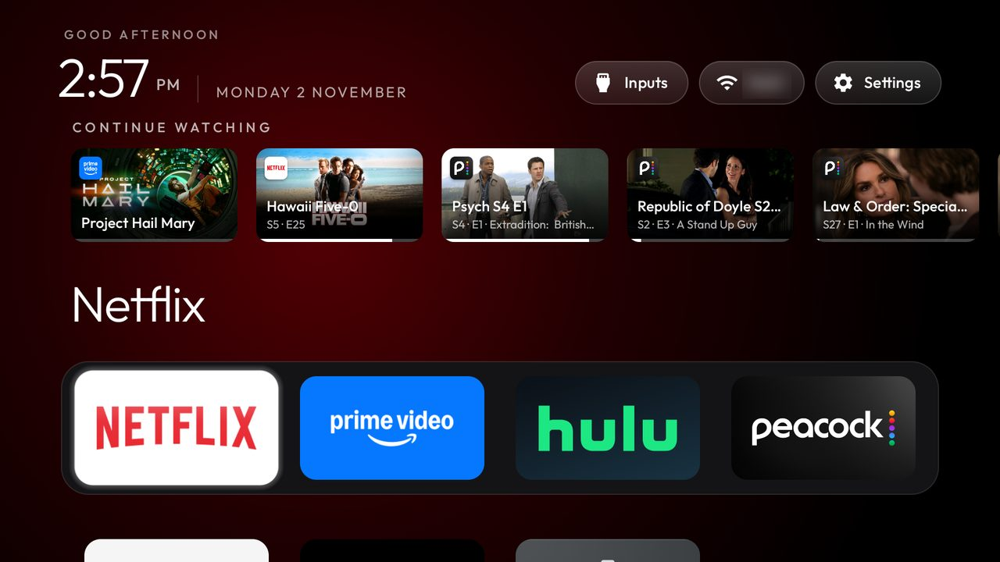

# burnhamrobertp/cleanyourtv: Continue watching, with real posters and an offline launcher

A fork of [Gathin23/cleanyourtv](https://github.com/Gathin23/cleanyourtv) carrying
[gwiersma](https://github.com/gwiersma)'s Continue watching row
([their fork](https://github.com/gwiersma/cleanyourtv/blob/main/FORK.md), their commit kept as-is), plus fixes from
a few days on two TVs and a separate add-on that fetches posters, so the launcher itself still never goes online.

**Tested on:** two 55" TCL Google TVs (G10, `G10_4K_US_NF`, Android 12, `STT2.230203.001`), launcherx disabled.
Netflix, Peacock and Prime Video publish Watch Next rows there, every poster `https://`.

## What it changes on top of the row

- **Real posters, launcher still offline.** [`addons/posters`](addons/posters/) is a 9 KB app with no screen that
  holds `INTERNET` and serves `content://com.gathin.tvhome.posters/poster?url=...` to apps signed with its key.
  The launcher uses it only when it is installed and signed like the launcher; otherwise cards show the app's
  banner, as before. Contract: [`docs/modules.md`](docs/modules.md#posters-for-the-continue-watching-row-comgathintvhomeposters).
- **Keeps up with the table.** The row reloads when Watch Next changes while Home is up, not only on resume.
  Prime Video writes a title a minute or more after playback stops, and deletes and rewrites all its rows when it
  opens or closes; an app whose rows all vanish keeps its cards for 10 s so Home doesn't come back without them.
- **Each show's newest row.** One card per show used to keep the first row in table order, often the oldest.
- **Fits a 4-column dock.** The room check measured from the grid's padding line, 28 px above the dock card the
  title is placed from, so the row stayed hidden on a 4-column dock by 1 px.
- **No cut-off cards.** The row runs edge to edge and scrolls cards out through both margins; it used to clip
  them at the left margin (and the focused card's zoom with them) while running to the right edge.
- Each card shows the publishing app's icon; films filed as season 0, episode 0 (Peacock) show no season and episode numbers.
- Rows engaged in the last 7 days (was 60); the Watch Next query names its 13 columns (a `null` projection
  fails on a Philips TPM191E, see [`docs/watch-next.md`](docs/watch-next.md)).

## Building

As upstream, with `continue_watching` set to `true` in `launcher/app/src/main/res/values/config.xml`:
`TV_HOST=<tv ip> launcher/build-and-install.sh`. For posters, build `addons/posters` the same way (both in
Docker, or both natively, so they share a key) and install it like any add-on. The launcher APK is about 5 KB
over upstream's size gate with these changes, so this lives here rather than upstream.
